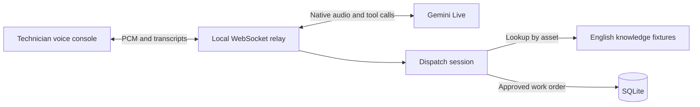

# Architecture

Technicians report symptoms by voice while on site. Records currently sit across a maintenance manual, a prior ticket and a stock listing. The dispatcher retrieves all three by asset, cites the records it used, and turns the technician's approved inspection request into a saved work order.

The browser sends mono 16 kHz PCM through the relay. Gemini recognizes the spoken request, calls the retrieval tool and streams audio back. When Gemini reports an interruption, the browser clears its playback queue. The latency display estimates the interval between the last microphone frame above the local speech threshold and scheduled first playback. It can shift with acoustic noise and device buffering.

The server stages a work order before accepting explicit confirmation from the input transcript. Draft and transcript state are scoped to a single connection. The save is transactional, and the work-order ID is the database key. The Gemini API key stays in the server process.

A company pilot would need employee identity, asset permissions, confirmation auditing, streaming telemetry and connectors to approved enterprise systems. This build exercises that flow locally with fixture records and a SQLite write. The rehearsal is a separate scripted WebSocket route.
